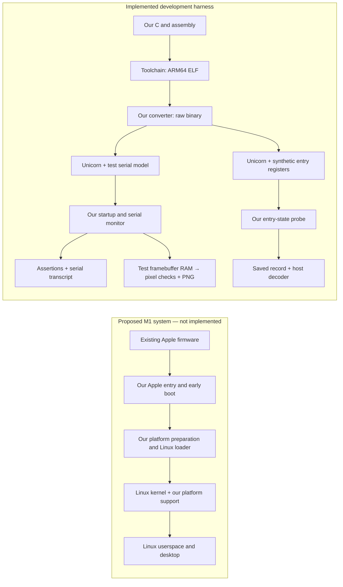

# Independent Apple Silicon Linux — living blueprint

Last updated: **2026-09-27** · Revision **9** · First target: **M1 MacBook Pro (MacBookPro17,1), 8 GB RAM**

Read each row from left to right: **what we want to build → what exists today → what proves progress**.
This is the project's central design and progress document. Update it alongside
each implementation change; the history at the bottom preserves earlier steps.

## Goal and present state, side by side

| Overall goal / intended design | Current implementation / understanding |
| --- | --- |
| Run Linux directly on the M1 using independently authored boot and platform-support code. | An original ARM64 monitor and a separate entry-state probe run in an instruction emulator. **Neither has booted on the M1 or loaded Linux.** |
| Start with one precisely identified Mac, then consider other models after hardware validation. | The development host identifies as MacBookPro17,1. No physical-target boot has been attempted. |
| Implement our own loader, research tools, and required platform drivers. | Startup assembly, exception vectors with crash reports, monitor, platform-neutral framebuffer text console, entry-state probe, linker layouts, binary converter, font generator, framebuffer image exporter, saved-record and `boot_args` decoders, Linux Image header parser and load planner, device-tree builder, and tests exist. Apple CustomOS research is documented; no Asahi, m1n1, or U-Boot code is included. |
| Be open source, usable by anyone, and able to grow to more machines and contributors. | GPL-2.0-or-later [LICENSE](../LICENSE) and SPDX tags on every source file (enforced by a test), [CONTRIBUTING.md](../CONTRIBUTING.md), and a board-support interface ([platform.h](../src/platform.h)); a new machine is one `platform/<name>/` directory. Not yet published to a public repository. |
| Use the existing Linux kernel as the operating-system core. | This remains the working scope of “Linux-based.” No Linux kernel source, patches, or image are included yet; header parsing and load planning follow the kernel's arm64 boot documentation. Writing a replacement kernel would change the project into a separate OS. |
| Eventually provide storage, input, networking, graphics, audio, and a usable Linux environment. | None of these M1 hardware capabilities has been implemented or verified. |
| Make builds, updates, installation, and recovery repeatable. | Version-pinned tools build both payloads. A CI workflow for Linux and macOS is defined but has not run yet. Eighty-seven host tests and both emulator suites pass; the probe report includes an artifact hash. Installer, update, and recovery tooling are future work. |

**Independence boundary:** project boot code and future hardware support are ours;
Apple's existing firmware, the Linux kernel, and development tools are external
foundations. Independently authored does not imply an audited clean-room process.
Record research sources and observations in [RESEARCH.md](RESEARCH.md).

## Architecture, side by side

The target flow below is a **proposed architecture**. Its Apple entry interface
and several hardware dependencies still need to be established experimentally.

| Intended M1 system, from power-on to applications | Current development path |
| --- | --- |
| **1. Apple firmware → our payload:** establish the authorized custom-boot route and the exact executable/entry contract. | **1. Host build:** [Makefile](../Makefile) produces two ARM64 ELF images; `PLATFORM=<name>` selects the monitor's [board support](../platform/README.md) (only `qemu-virt` exists). [Primary-source research](APPLE_BOOT.md) establishes a documented CustomOS route, but does not establish our hardware entry contract. |
| **2. Our early boot stage:** establish an output channel, entry state, stack, memory ownership, and exception handling. | **2. Image preparation:** [ELF converter](../tools/elf_to_binary.py) supports the monitor's fixed base and the separate probe's base-zero layout. Relative probe instructions permit relocation in tests; zero is not an Apple load-address proposal. |
| **3. Our platform preparation:** describe hardware and reserved memory, prepare devices required for boot, and load a kernel plus initial filesystem. | **3. Test harnesses:** the [monitor test](../tests/emulate.py) models serial registers; the [probe test](../tests/emulate_probe.py) seeds synthetic CPU state and executes the same bytes at three addresses. |
| **4. Linux handoff:** meet the ARM64 kernel entry requirements and transfer control to Linux. | **4. Our entry code:** [monitor startup](../src/start.S) installs [exception vectors](../src/vectors.S) and enters C; the separate [entry probe](../src/entry_probe.S) records incoming registers and parks without using a stack or dereferencing arguments. Neither transfers control to Linux. |
| **5. Linux + our platform support:** bring up the CPU/platform services and drivers required to reach an initial shell, then enable more devices. | **5. Our monitor:** [monitor.c](../src/monitor.c) prints a banner and provides an interactive command console (`help`, `info`, `status`, `echo`, `dump`, `peek`, `poke`, `regs`, `probe`, `kimage`, `fb`, `trap`, `clear`). CPU exceptions print a [report](../src/exception.c) and return to the prompt. `fb` mirrors console output to a caller-described 32-bpp framebuffer through [framebuffer.c](../src/framebuffer.c). An interactive host runner [tools/console_ui.py](../tools/console_ui.py) (`make console`) provides live terminal interaction. Execution stays in the monitor. |
| **6. Linux userspace:** persistent root filesystem, services, packages, and eventually a desktop. | **6. Evidence:** [serial transcript](../build/serial-test.log), [framebuffer snapshot](../build/fb-test.png) exported by [fb_export.py](../tools/fb_export.py), [probe report](../build/probe-test.json), an [offline record decoder](../tools/inspect_probe.py), and a [`boot_args` decoder](../tools/inspect_bootargs.py). The probe report and framebuffer are synthetic test memory, and there is no Linux userspace. |

The development harness lets us exercise original code before physical boot is
available. It does **not** emulate an M1. QEMU `virt` is also a different platform;
the monitor's serial address and link address apply only to that development target.

## Component status and evidence

Status meanings: **Verified — emulator** means compiled instructions ran in
Unicorn; **Implemented** means source exists but its full behavior is not proven;
**Configured** means a launch recipe exists but has not run here; **Research**
means a needed interface is unknown; **Planned** means no implementation yet.

| Component / intended responsibility | State today | Evidence / limit / next step |
| --- | --- | --- |
| Build pipeline: produce boot-stage artifacts | **Implemented; build passed on macOS** | Monitor and entry-probe ELF/raw images build. `make probe` selects the probe; an unknown `PLATFORM` fails with the list of available boards. Dependencies are in [requirements-dev.txt](../requirements-dev.txt). The [CI workflow](../.github/workflows/ci.yml) for Linux and macOS has not run yet; Linux hosts and reproducibility across hosts are unchecked. |
| Platform abstraction | **Verified — emulator (one platform)** | The monitor reaches devices only through [platform.h](../src/platform.h). [qemu-virt](../platform/qemu-virt/platform.c) is the only implementation and passes the unchanged monitor tests. No Apple platform exists; adding one requires sourced device details. |
| Binary packaging | **Verified — host tests; not Apple acceptance** | 24 converter tests cover configurable bases, valid layouts, malformed headers, bounds, memory overlaps including BSS, and file-backed executable entry. This extracts raw bytes; it does not sign/install an Apple boot object. |
| CPU entry, stack, BSS initialization | **Verified — emulator** | Startup reaches the C monitor; test RAM is deliberately nonzero before entry. Apple CPU entry state remains unknown. |
| Exception vectors and crash reports | **Verified — emulator, synthetic entry** | [vectors.S](../src/vectors.S) is installed in `VBAR_EL1` or `VBAR_EL2`. Each entry saves x0–x30; [exception.c](../src/exception.c) reports the kind, ESR with decoded class, ELR, FAR (only when valid), SPSR, SP, and all registers to serial and framebuffer. It then resumes the prompt with a fresh stack; a fault during a report halts. Unicorn does not vector exceptions, so the harness performs EL1 exception entry itself for BRK (`trap`) and unmapped read/write aborts, then checks every printed register against CPU state. Real exception entry, the EL2 path, IRQ/FIQ/SError, and faults with an unusable SP are untested. |
| Console and command input | **Verified — emulator and host runner** | Commands, CRLF, backspace, unknown input, overlong-line recovery, and UI commands (`echo`, `clear`, `peek`, `poke`, `dump`, `regs`, `probe`) passed in Unicorn. Live interactive runner `tools/console_ui.py` tested. The serial register model is simplified. |
| Framebuffer text console | **Verified — emulator; no display hardware** | [framebuffer.c](../src/framebuffer.c) draws 8×16 glyphs (scale 1–8) into caller-supplied little-endian `0x00RRGGBB` memory, with wrap, backspace, scroll, and clear. The monitor rejects misaligned, undersized, oversized, or self-overlapping buffers. Unicorn tests compare every pixel and all stride padding against an independent Python model at three geometries. The font source ([font8x16.txt](../tools/font8x16.txt)) regenerates [font.h](../src/font.h) byte-identically via `make font`; glyphs now share consistent metrics across all 16 rows (line gap on row 0, capitals on rows 2–13, descenders on 14–15). No real display, QEMU `ramfb`, or Apple framebuffer has been driven. |
| QEMU device-model execution | **Configured; unverified — blocked** | `make run` exists, but QEMU is not installed. This Mac has no Homebrew (installing it needs an administrator), and conda-forge has no macOS QEMU; an unvetted personal-channel build was not used. There is no QEMU boot log. |
| Entry-state probe and record decoder | **Verified — host tests and emulator** | A 184-byte probe captures `x0`–`x3`, SP, entry address, CurrentEL, and DAIF, then parks. Three relocation/mask cases pass at little-endian EL1; 16 decoder tests pass. EL2/EL3 execution, Apple mappings, and physical retrieval are unverified. [Design](ENTRY_PROBE.md). |
| Apple custom-boot entry and payload format | **Research — source-backed route; hardware unverified** | Apple documents CustomOS control transfer; local `kmutil` help documents raw payload virtual mapping/entry parameters. Historical XNU supports an `x0` boot-argument hypothesis. None proves our payload's acceptance or entry state. [Evidence](APPLE_BOOT.md). |
| `boot_args` capture decoder | **Verified — host tests; synthetic input only** | [inspect_bootargs.py](../tools/inspect_bootargs.py) decodes a saved 736-byte capture using the layout of Apple's pinned XNU header, including Video depth/rotate/scale packing and revision-2 `bootFlags`. It rejects wrong sizes and unknown revisions, warns on inconsistencies, and never follows pointers. A separate ctypes restatement confirms every offset. No real capture exists; whether our payload receives `boot_args` is unverified. |
| Apple output and hardware diagnostics | **Planned** | Exception reports and a platform-neutral text renderer exist, but no Apple framebuffer address, pixel format, writeability, or cache behavior is known. The candidate `boot_args` Video fields in [APPLE_BOOT.md](APPLE_BOOT.md) are unverified. Still needed: a verified output path, hardware description, timer, and memory/cache rules. |
| Linux Image + initial filesystem loading | **Partial — host tests and emulator; no kernel loaded** | [linux_boot.c](../src/linux_boot.c) (portable C, also built as a host library so tests run the same code) validates the 64-byte Image header and plans 2 MB-aligned kernel, DTB, and initrd placement per `booting.rst`, including the 2 MB DTB limit and the 1 GB-aligned 32 GB initrd window. The monitor's `kimage` command uses it. [fdt.py](../tools/fdt.py) builds/parses DTBs; a third-party parser decoded its output identically. Its minimal tree has only memory and `/chosen`. No image transfer, cache maintenance, handoff jump, real kernel, or initramfs exists. |
| M1 Linux platform services and drivers | **Planned** | No interrupt-controller, SMP, IOMMU, storage, USB, networking, GPU, audio, or power-management implementation exists. |
| Distribution, installer, and updates | **Planned** | Depends on reliable hardware boot, storage, and a tested recovery procedure. |

## Milestones and the proof needed to advance

These are completion gates, not calendar estimates. Some minimum hardware support
will be needed before the first Linux shell; broad device support comes afterward.

| Goal / architecture milestone | Current progress | Completion evidence |
| --- | --- | --- |
| **M0 — Executable foundation** | Emulator monitor implemented and tested. Separate QEMU validation is pending. | Compiled ARM64 startup and command handling pass integration tests. This gate is met at the instruction-emulator level only. |
| **M1 — Independent Apple entry** | In progress: primary-source route documented; original entry probe and decoder tested synthetically. Physical execution conditions and record retrieval remain unresolved. | Documented entry ABI, our payload packager, and a repeatable visible marker from our code on the physical M1. **Gate not met.** |
| **M2 — Hardware diagnostics** | Preparation only: exception reports, a text console, and a `boot_args` decoder pass emulator/host tests. | Repeated cold boots produce stable diagnostics and captured exception reports, with device/firmware details. |
| **M3 — Linux shell on M1** | Groundwork only: Image header validation, load planning, and DTB building pass host tests. | Our loader and required platform support reach an initramfs shell on the physical target, with saved boot logs. |
| **M4 — Hardware enablement** | Planned; work may overlap M3 as dependencies become clear. | Per-device support matrix backed by hardware tests, including failures and limitations. |
| **M5 — Usable distribution** | Planned. | Repeatable installation, persistent storage, updates, recovery, and a documented usable Linux environment. |

Detailed scope: [ROADMAP.md](ROADMAP.md).

## Immediate next work and open decisions

| Question / work item | Why it matters | Result to record here |
| --- | --- | --- |
| Establish actual entry privilege, endianness, mapping address, permissions, and cache state. | The raw interface is documented, but the probe still assumes conditions not observed on M1. | Source-backed or measured entry contract for the target firmware; a concrete payload preparation plan. |
| Choose a physical debug/output path and determine whether a second machine is needed. | The probe only stores a RAM record. Rebooting does not provide a way to retrieve it. A firmware-initialised display could show text without extra equipment, if its geometry can be obtained safely. | Equipment/transport requirements and a capture or visible-output experiment with known cache rules. For the display route: a sourced or measured framebuffer base, stride, size, and pixel format before any write. |
| Validate `make run` with QEMU. Needs Homebrew (administrator password) then `brew install qemu`. | Exercises real exception entry, EL2, and the platform device model beyond Unicorn; also enables a first Linux boot of the handoff code on QEMU virt. | QEMU version, command, result, and captured log. |
| Identify the minimum M1 platform support Linux needs for the first shell. | A loader alone cannot provide a working Linux system. | Dependency list and kernel integration plan supported by research. |

## Update history

Append a row for each meaningful development step. Keep the architecture and
status tables above synchronized with the newest evidence.

| Date / revision | What changed | Contribution to the goal / architecture | Validation and remaining gap |
| --- | --- | --- | --- |
| 2026-09-27 / **1** | Created ARM64 startup, linker layout, serial monitor, build pipeline, ELF converter, and emulator tests. Added roadmap and research notes. | Established an executable foundation for original low-level code. | `make test` passed startup/console cases in Unicorn. No Apple boot, Linux handoff, or QEMU device-model validation. |
| 2026-09-27 / **2** | Added this side-by-side blueprint and repository instructions to maintain it with future changes. Linked it from the existing documentation. | Connected the overall system goal to current code, evidence, and next milestones. | Documentation checked against source and existing test transcript. No runtime changes; prior test result retained. |
| 2026-09-27 / **3** | Enhanced embedded monitor UI in `src/monitor.c` with hex formatting, argument parsing, memory inspection (`peek`, `poke`, `dump`), `echo`, and `clear`. Expanded `tests/emulate.py` to verify UI commands. | Improved diagnostic and inspection user interface for low-level platform research and debugging. | `make test` passed all baseline regression tests plus new UI command tests in Unicorn. No Apple boot or QEMU device-model validation. |
| 2026-09-27 / **4** | Added primary-source Apple CustomOS research, original relocatable entry probe, offline record decoder, configurable validated ELF extraction, and tests. | Prepared an independent way to capture first-entry state once a physical retrieval path is established. | `make test` passed 40 host tests, monitor regressions, and probe relocation/capture/parking tests at three addresses in little-endian EL1. Read/execute-only memory rejects the probe's write as expected. EL2/EL3 execution, QEMU execution, and physical M1 boot remain unverified. |
| 2026-09-27 / **5** | Extended monitor UI with CPU register inspection (`regs`) and probe record decoding (`probe`). Created interactive terminal console runner [tools/console_ui.py](../tools/console_ui.py) (`make console`) with unit tests. | Linked embedded serial monitor UI to entry-probe inspection; enabled live interactive console sessions in Unicorn without requiring QEMU. | `make test` passed 43 host unit tests, monitor regressions with new UI commands, and probe relocation/parking tests in Unicorn. |
| 2026-09-27 / **6** | Completed the interrupted framebuffer work: platform-neutral text console ([framebuffer.c](../src/framebuffer.c)), monitor `fb` command with output mirroring and bounds/overlap checks, editable font source plus [generator](../tools/generate_font.py) with `--check`, and [PNG/PPM exporter](../tools/fb_export.py) for saved dumps. | Provides the text-rendering half of a possible first visible-output path, independent of any UART, once a real framebuffer description is established. | `make test` passed 56 host tests (including 9 exporter and 4 font tests), the font freshness check, monitor regressions, framebuffer pixel/stride/scale/wrap/scroll/clear/validation cases, and probe tests, all in Unicorn. Deliberate renderer mutations (bit order, scroll offset, scale, backspace) were each caught. No QEMU display, Apple framebuffer, or physical-M1 output. |
| 2026-09-27 / **7** | Prepared the project for open-source use: GPL-2.0-or-later license (copyright: the project contributors), SPDX tags on all sources (the font generator emits one), repository-convention tests, [CONTRIBUTING.md](../CONTRIBUTING.md) with DCO sign-off and provenance rules, [platform guide](../platform/README.md), and a Linux/macOS CI workflow. Moved PL011 code into `platform/qemu-virt/` behind [platform.h](../src/platform.h). | Anyone can use, study, and extend the code under clear terms; new machines, including a future M1 platform, plug in as one directory without editing the monitor. | `make test` passed 59 host tests (3 new repository tests), the font check, all monitor/framebuffer regressions, and probe tests in Unicorn on macOS. CI has not executed; a local git repository exists, but nothing has been pushed to a public remote yet. No QEMU or physical-M1 validation. |
| 2026-09-27 / **8** | Added exception vectors with crash reports and recovery (`trap` command, exception count in `status`, VBAR in `regs`) and an offline `boot_args` decoder. Recorded the verified header details in the research log. | Gives the monitor the captured-exception reporting M2 requires and prepares to read display geometry from a future capture. | `make test` passed 70 host tests (11 new decoder tests) and all Unicorn suites, including exception report/recovery with harness-performed EL1 exception entry. Six deliberate vector/handler mutations were each caught. No QEMU, EL2, or physical-M1 validation. |
| 2026-09-27 / **9** | Redesigned the font to use all 16 rows with consistent metrics. Added portable Linux Image header parsing and load-address planning ([linux_boot.c](../src/linux_boot.c)), the `kimage` monitor command, a host build of that C for tests (`make host`), and a DTB builder/parser ([fdt.py](../tools/fdt.py)). Attempted QEMU installation; blocked. | Starts milestone M3 groundwork: the loader's placement rules now exist as tested code shared by host tests and the monitor. | `make test` passed 87 host tests (9 planner, 8 DTB), including a hand-assembled golden DTB, plus all Unicorn suites with `kimage` cases. A third-party `fdt` 0.3.3 parser (throwaway environment) decoded a generated DTB identically. No kernel was loaded; no QEMU or physical-M1 validation. |

Latest probe validation: Zig **0.14.1**, Unicorn **2.1.4**; image size **184 bytes**.
Synthetic addresses: `0x40080000`, `0x800100000`, `0x1000000000`; original DAIF
masks: `0x0`, `0x3c0`, `0x140`. These are test inputs, not Apple address findings.
The [generated report](../build/probe-test.json) records the tested SHA-256 digest.
This Unicorn setup reports EL1 even when PSTATE is seeded for EL2; those higher
exception levels are not counted as executed coverage.

### How we maintain this document

For each implementation change:

1. Update the affected architecture/component rows, including files and current limits.
2. Record what was actually validated and where: build only, Unicorn, QEMU, or physical M1.
3. Update the milestone and immediate-next-work rows if the change affects them.
4. Append a dated history entry and advance the revision at the top.
5. Put raw research and detailed observations in [RESEARCH.md](RESEARCH.md), and
   change [ROADMAP.md](ROADMAP.md) if milestone scope changes.

This is maintained as part of project work; it is not an automatic background tracker.
Generated files under `build/` can disappear after `make clean`; the history should
retain the validation summary even when the local transcript is gone.

## Terms used in this blueprint

| Term | Meaning here |
| --- | --- |
| ARM64 | The CPU instruction architecture used by the monitor and the target Mac. Sharing it does not imply shared devices. |
| Payload / early boot stage | Our first program executed before Linux. |
| ABI / entry contract | The agreed registers, memory layout, and CPU state when one boot stage enters another. |
| BSS | Storage for variables that must begin at zero; startup code clears it. |
| UART / serial console | A basic text input/output device, useful before a full display driver exists. |
| Device tree | A hardware description supplied to Linux. |
| Initramfs | An initial filesystem loaded into memory; a useful place for the first Linux shell. |
| MMU / IOMMU | Hardware that translates CPU/device memory accesses. |
| Userspace | Applications and services running above the kernel. |
